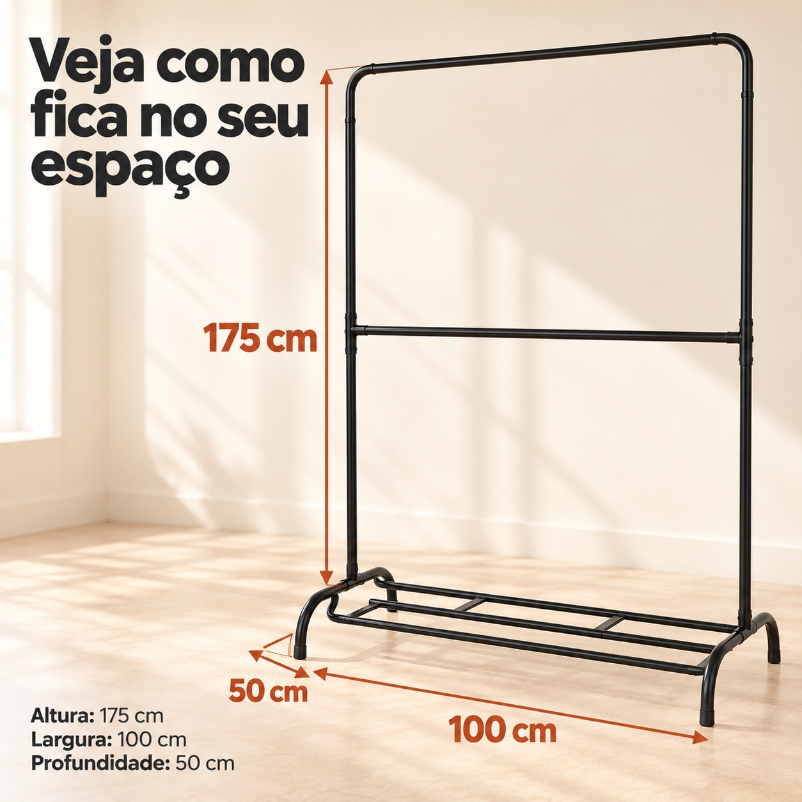
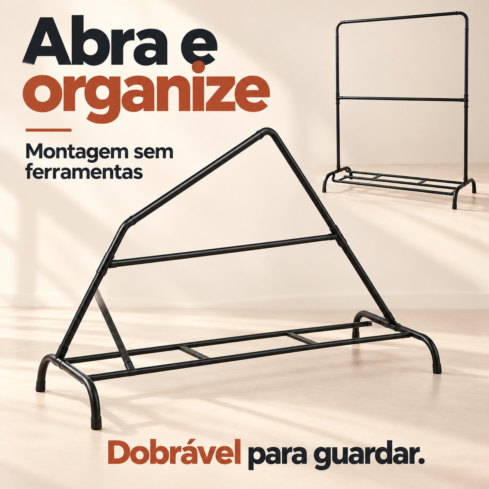
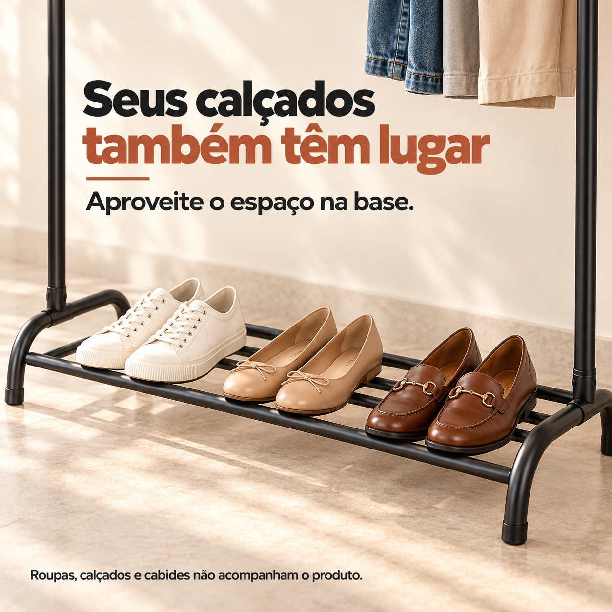

# 巴西 Shopee · 双层衣架详情图

5 张独立高清方图，1254 × 1254 px，比例 1:1，JPG 格式。图内语言：巴西葡萄牙语。

[下载本套 5 张图片 ZIP](https://github.com/ChaoDamn/-/raw/refs/heads/main/arara-shopee-br-1x1/arara-shopee-br-1x1.zip)

## 1. 整体收纳 / Organização

[下载原图](01-organizacao.jpg)

## 2. 尺寸 / Medidas

[下载原图](02-medidas.jpg)

## 3. 折叠展开 / Dobrável

[下载原图](03-dobravel.jpg)

## 4. 双层挂衣 / Dois níveis

[下载原图](04-dois-niveis.jpg)

## 5. 底部置鞋 / Calçados

[下载原图](05-calcados.jpg)

尺寸依据用户资料：高 175 cm、宽 100 cm、深 50 cm。图片中的衣物、鞋和衣架用于场景展示。
