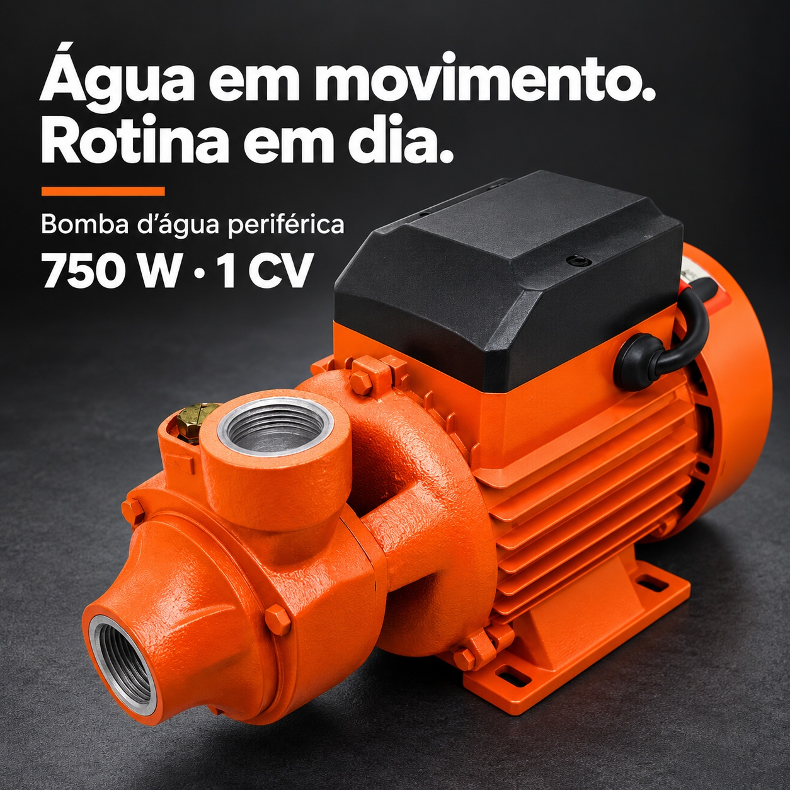
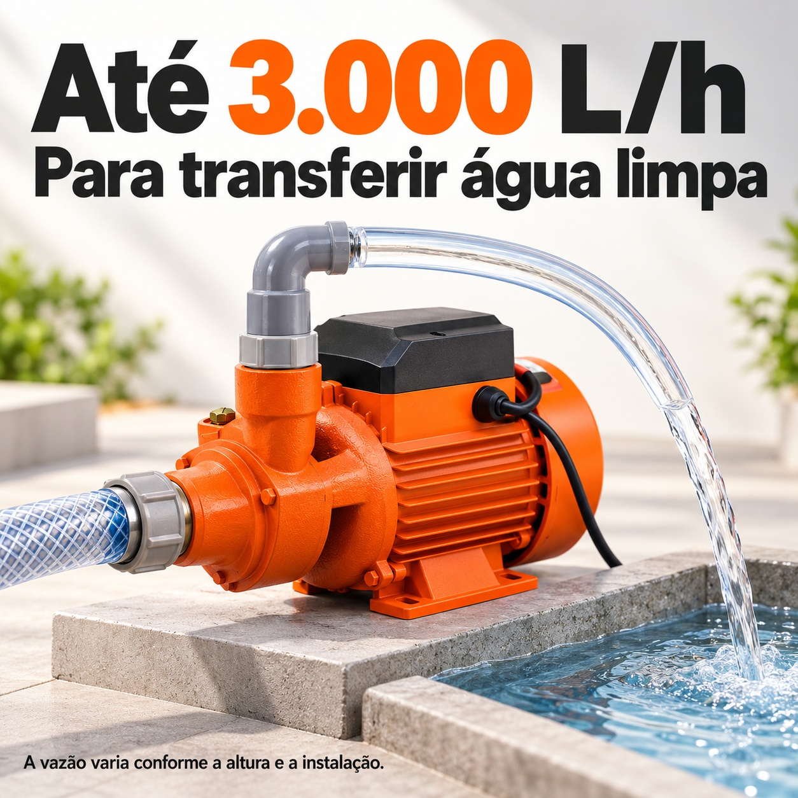
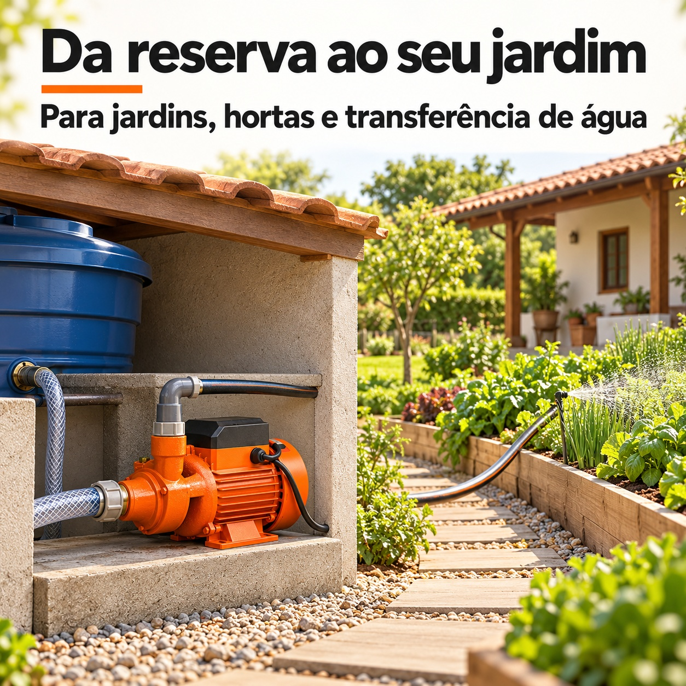
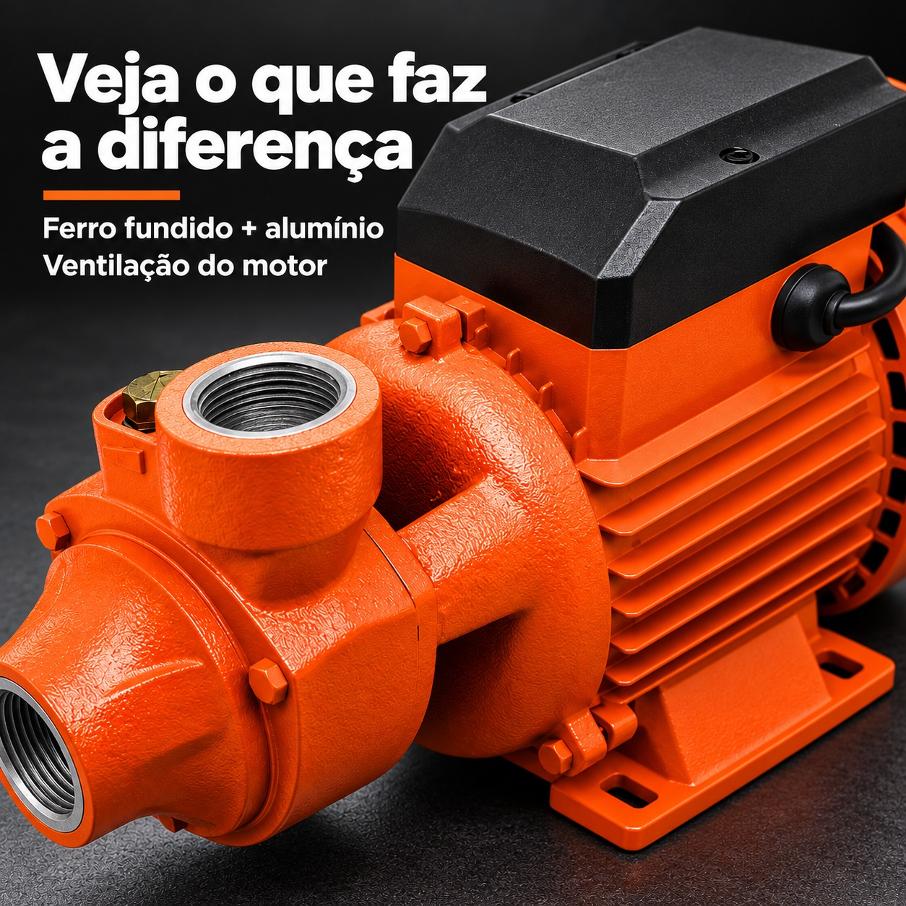
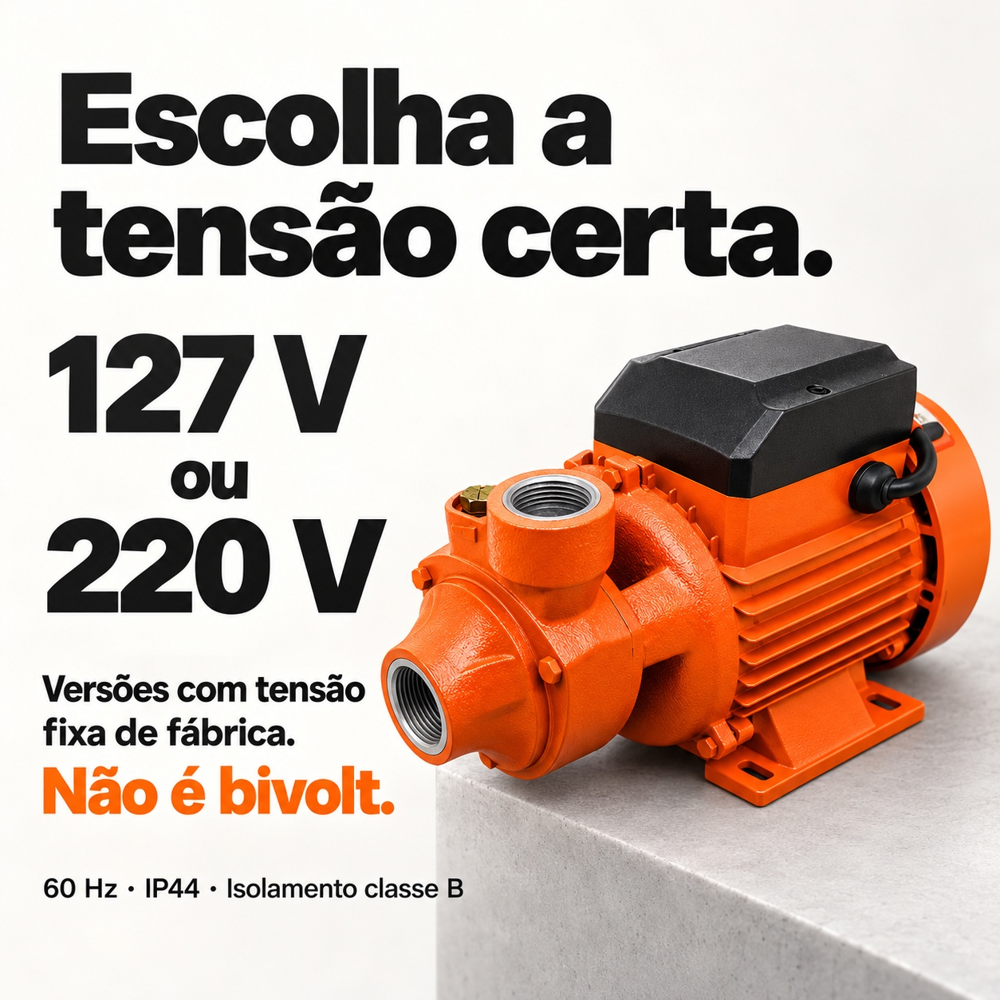
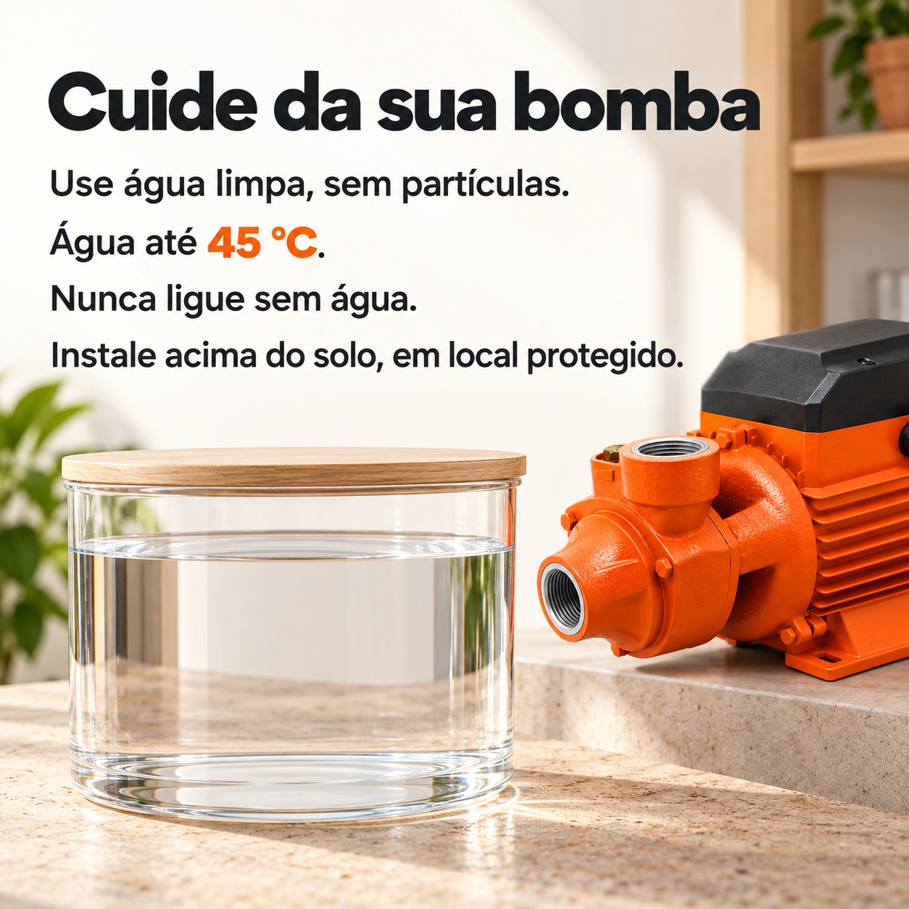

# 750W 外围水泵 · 巴西 Shopee A+ 风格详情图

6 张独立高清 JPG，1254 × 1254 px，1:1，图内语言为巴西葡萄牙语。整套以炭黑、暖白及产品橙色统一，每张图承担不同作用。

[一键下载本次六张图 ZIP](https://github.com/ChaoDamn/-/raw/refs/heads/main/bomba-periferica-750w-shopee-br-1x1/bomba-periferica-750w-shopee-br-1x1.zip)

|图片|作用|
|---|---|
|1 · 产品主视觉与功率|介绍橙色外围泵，750W／1CV|
|2 · 最大流量性能|Até 3.000 L/h；实际流量受扬程与安装影响|
|3 · 庭院／菜园使用场景|地上受保护的水泵为庭院菜园转移清水|
|4 · 材料与散热结构|铸铁＋铝，实际泵体表面与散热鳍片特写|
|5 · 电压选择|127V或220V出厂固定；不是双电压|
|6 · 正确使用须知|清水无颗粒、45°C以内、禁止无水运行、地上受保护安装|

## 1. 产品主视觉与功率 / Produto e potência

[打开 JPG 原图](01-produto-potencia.jpg)

## 2. 最大流量性能 / Vazão máxima

[打开 JPG 原图](02-vazao-agua-limpa.jpg)

## 3. 庭院／菜园使用场景 / Aplicações

[打开 JPG 原图](03-aplicacoes-jardim-horta.jpg)

## 4. 材料与散热结构 / Construção e ventilação

[打开 JPG 原图](04-construcao-ventilacao.jpg)

## 5. 电压选择 / Escolha da tensão

[打开 JPG 原图](05-escolha-voltagem.jpg)

## 6. 正确使用须知 / Cuidados de uso

[打开 JPG 原图](06-cuidados-uso-correto.jpg)

产品规格来自用户提供的资料：750W/1CV，60Hz，最大3000L/h，127V或220V出厂固定，IP44，绝缘等级B，最高液温45°C，铸铁＋铝，用于洁净无固体颗粒水，地上安装。

外接管件、容器、水箱与场景植物用于应用示意，不表示随产品附送。场景图不能替代产品安装说明；未提供扬程等数据，图片未作对应承诺。
