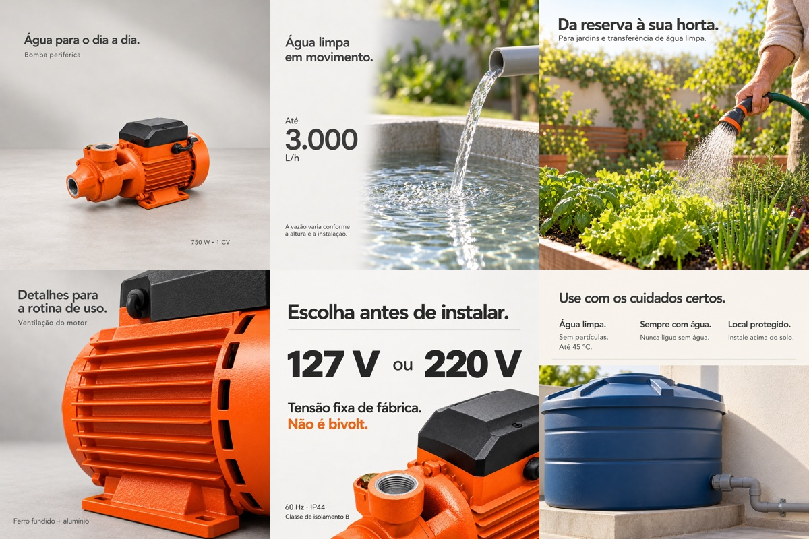
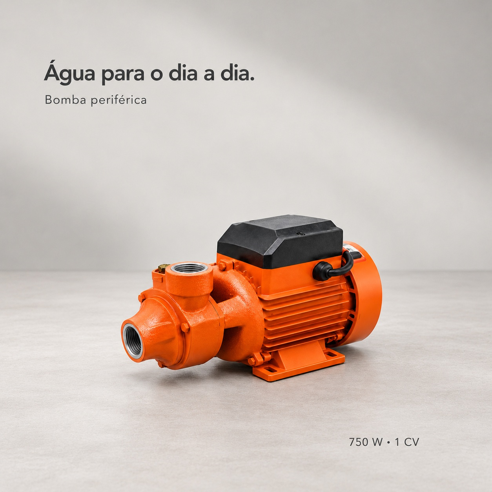
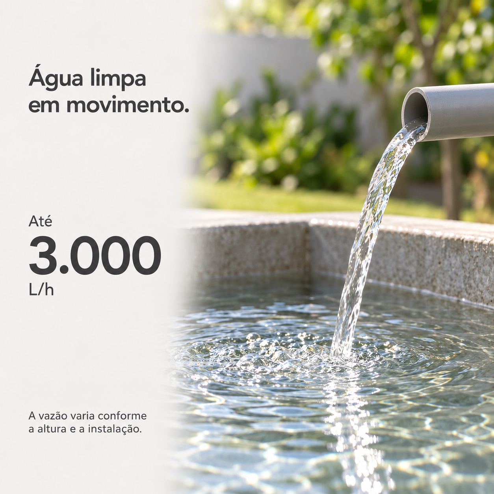
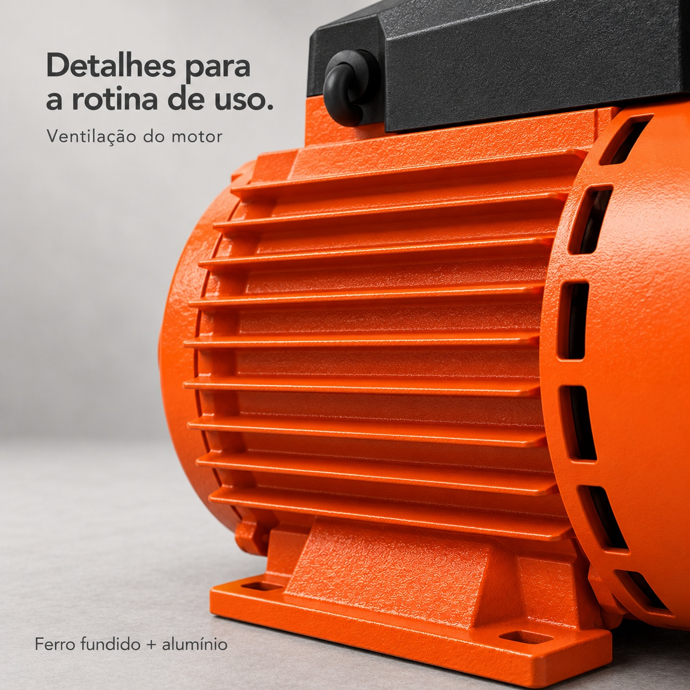
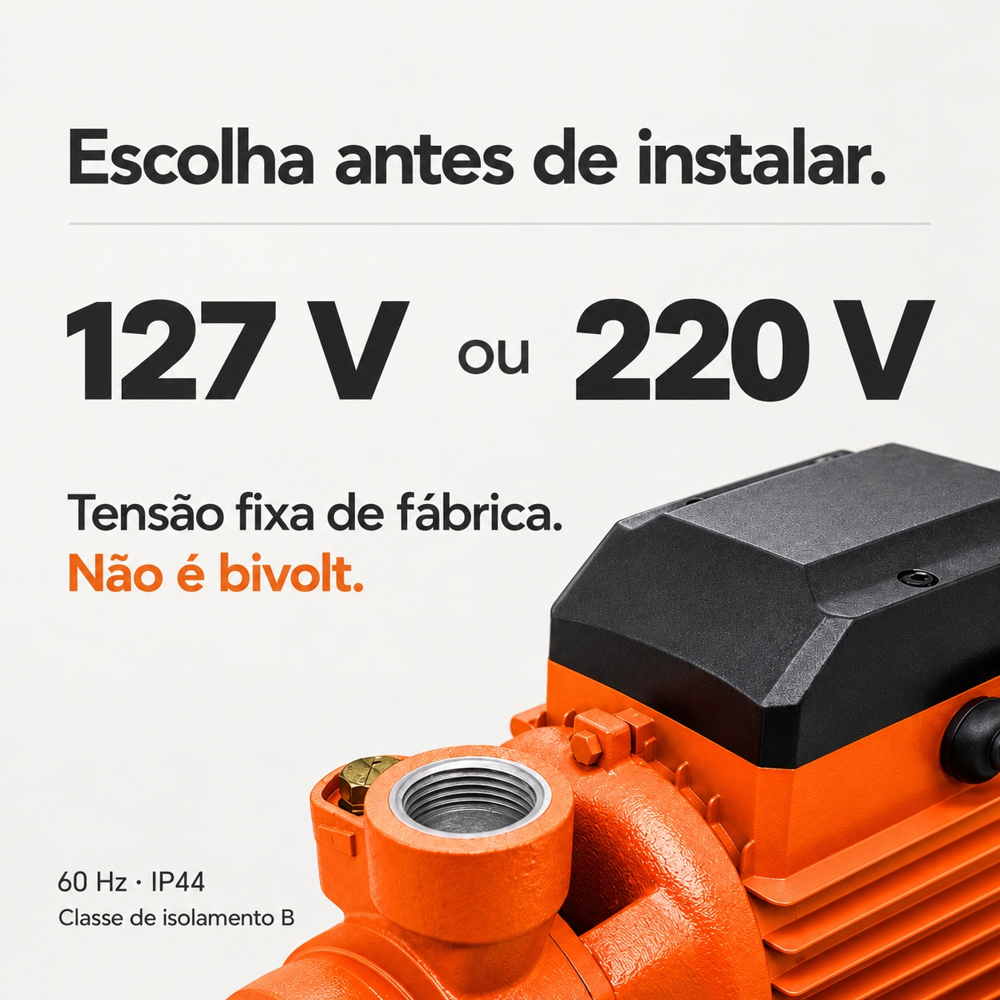
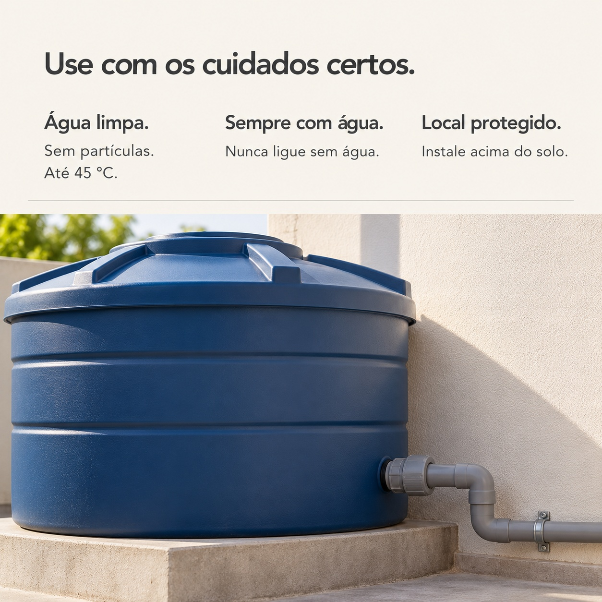

# 水泵详情图 V2 · 六张重新制作

巴西葡萄牙语 · 1254 × 1254 px · 1:1 · 六张独立高清 JPG。

[下载本次 V2 六张原图 ZIP](https://github.com/ChaoDamn/-/raw/refs/heads/main/bomba-periferica-750w-shopee-br-v2/bomba-periferica-750w-shopee-br-v2.zip)

## 新版六张总览

下图仅用于快速浏览，下载包里包含六张独立高清原图。

## 每张图片的作用

|图|作用|画面|
|---|---|---|
|1|产品与功率|安静影棚、完整产品、750W/1CV|
|2|最大流量|水流近景；最高3000L/h及实际流量限定|
|3|菜园使用|人的浇灌动作、真实园艺场景|
|4|电机细节|侧后方散热鳍片和通风壳局部|
|5|电压选择|127V或220V固定版本，明确不是双电压|
|6|使用须知|清水与45°C、禁止干转、保护安装|

## 1. 产品与功率 / Produto e potência

[打开高清 JPG](01-produto-750w.jpg)

## 2. 最大流量 / Transferência de água

[打开高清 JPG](02-vazao-transferencia.jpg)

## 3. 菜园使用 / Irrigação na horta

[打开高清 JPG](03-irrigacao-na-horta.jpg)

## 4. 电机细节 / Detalhes do motor

[打开高清 JPG](04-motor-em-detalhe.jpg)

## 5. 电压选择 / Escolha da tensão

[打开高清 JPG](05-escolha-a-tensao.jpg)

## 6. 使用须知 / Cuidados de uso

[打开高清 JPG](06-cuidados-de-uso.jpg)

本版在前版基础上重新制作：减少大标题，拉开完整产品、流水、人的应用、电机局部、选型和维护说明的视觉区别。第2、3、6张为输水/园艺/储水应用和维护说明配景，不表示管件、喷头、储水罐随产品附送。应用场景为示意，不替代产品安装说明。

参数依据用户提供资料：750W/1CV；最大3000L/h，实际流量受扬程和安装影响；127V或220V出厂固定，非双电压；60Hz；IP44；B级绝缘；最高液温45°C；只用于洁净无颗粒水。没有新增扬程、吸程、品牌型号或测试数据。
