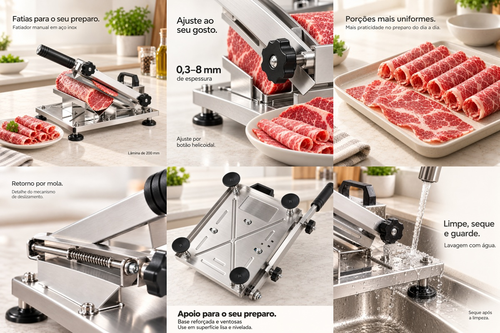
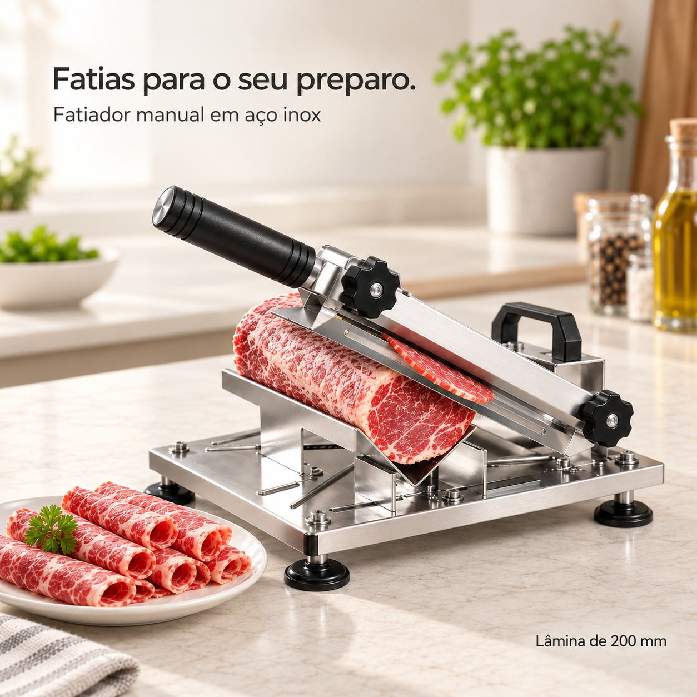
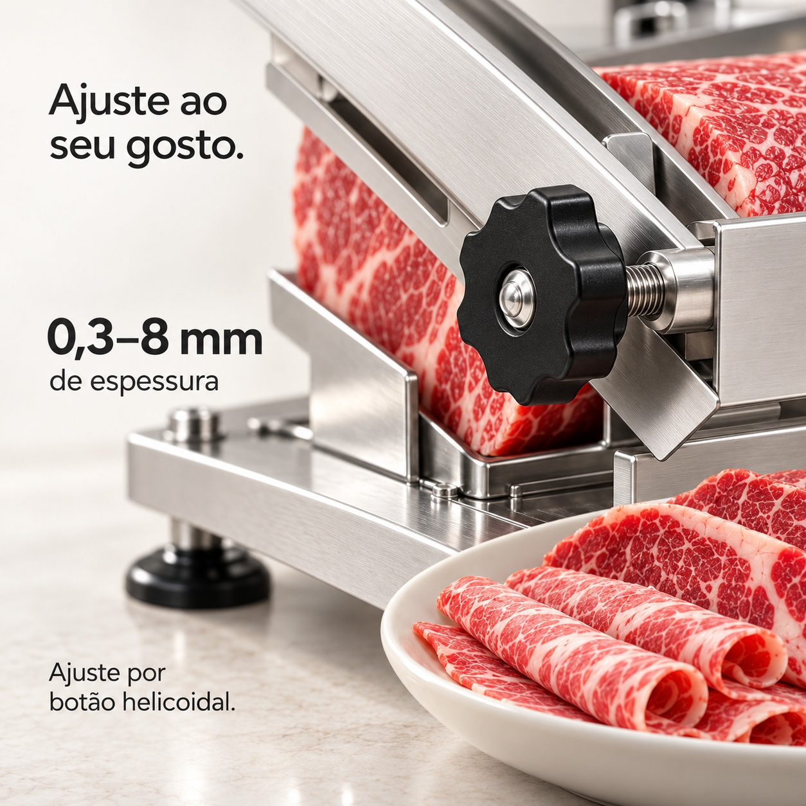
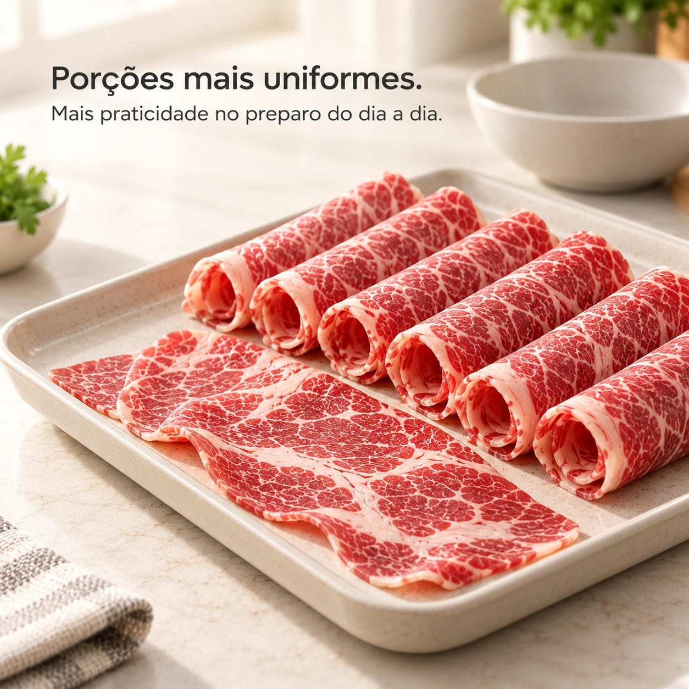
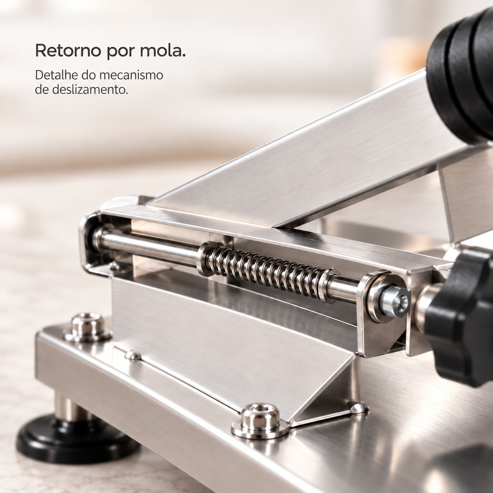
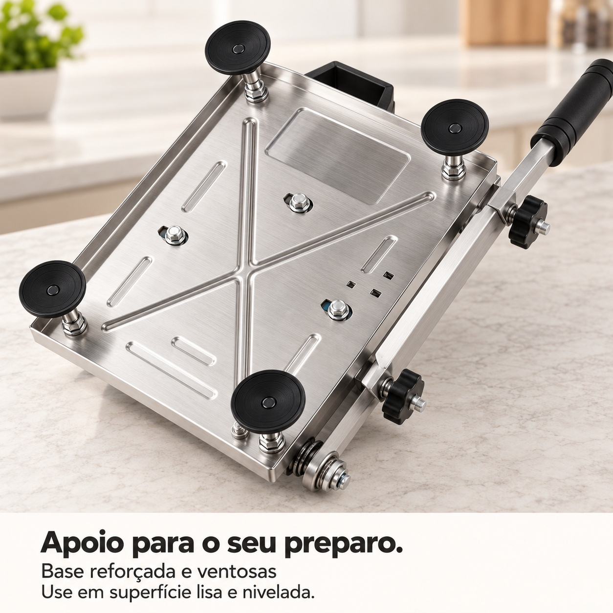

# 手动不锈钢切片器 · 巴西 Shopee 六张详情图

六张独立高清 JPG · 1254 × 1254 px · 1:1 · 巴西葡萄牙语。标题、说明与参数分层，部分标题已重新生成并缩小，避免大字遮挡产品。

[下载六张原图 ZIP](https://github.com/ChaoDamn/-/raw/refs/heads/main/fatiador-manual-inox-shopee-br/fatiador-manual-inox-shopee-br.zip)

## 六张总览

下图仅用于快速浏览；ZIP包含六张独立高清原图。

|图|作用|内容|
|---|---|---|
|1|产品与刀长|完整切片器、刀长200mm|
|2|可调厚度|0,3–8mm调节范围与旋钮局部|
|3|切片效果|食材切片与肉卷近景|
|4|弹簧机构|弹簧及导向杆局部|
|5|底座与吸盘|底部加强结构和四个吸盘|
|6|清洁护理|水洗、干燥与收纳提示|

## 1. 产品与刀长 / Produto e lâmina

[打开高清 JPG](01-fatiador-manual.jpg)

## 2. 可调厚度 / Ajuste da espessura

[打开高清 JPG](02-ajuste-de-espessura.jpg)

## 3. 切片效果 / Porções uniformes

[打开高清 JPG](03-porcoes-uniformes.jpg)

## 4. 弹簧机构 / Retorno por mola

[打开高清 JPG](04-retorno-por-mola.jpg)

## 5. 底座与吸盘 / Base e ventosas

[打开高清 JPG](05-base-e-ventosas.jpg)

## 6. 清洁护理 / Limpeza e cuidados

[打开高清 JPG](06-limpeza-e-cuidados.jpg)

产品信息根据用户提供资料及参考图：手动不锈钢切片器、200mm刀长、0,3–8mm可调厚度、回位弹簧、底座吸盘、水洗。食材、餐盘及厨房环境为使用配景，不表示随商品附送。切片效果为示意，受食材和操作方式影响。清洗及操作应遵循原产品说明。
