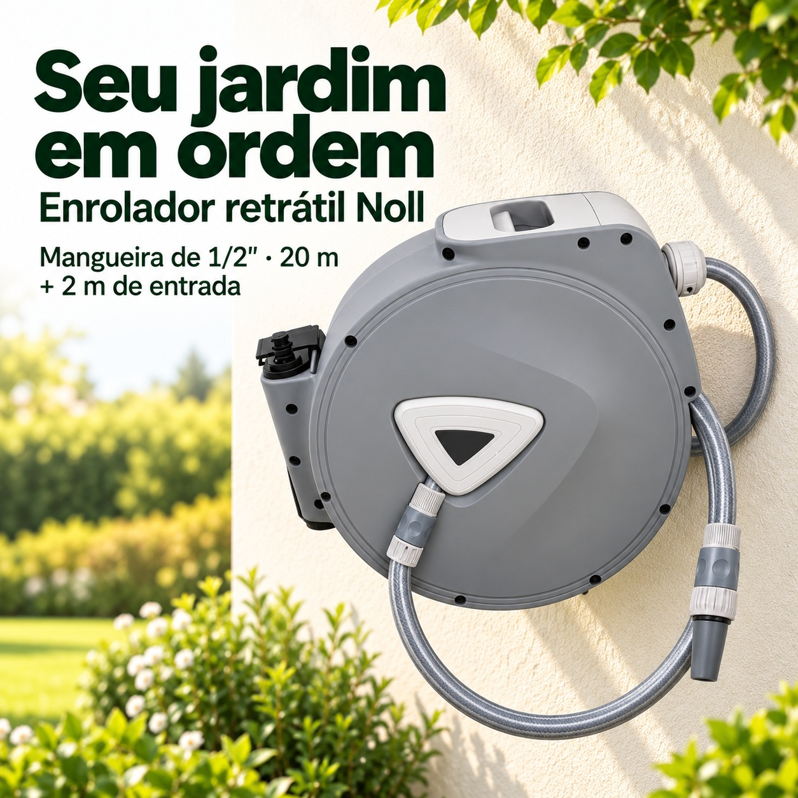
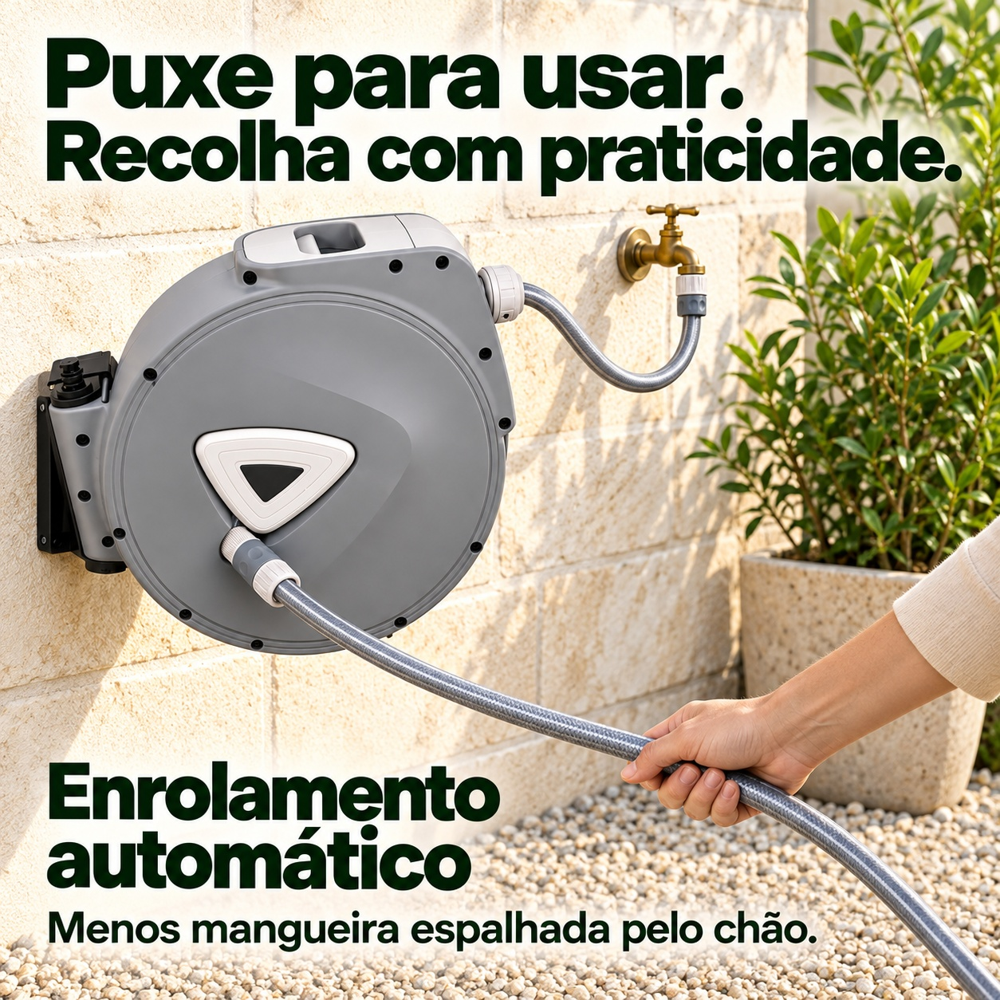
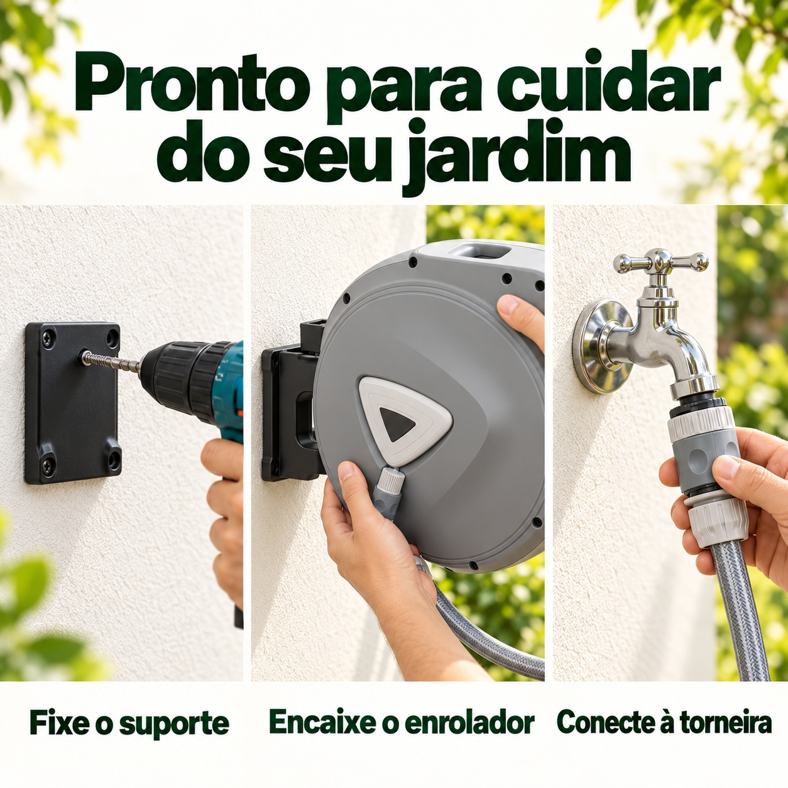
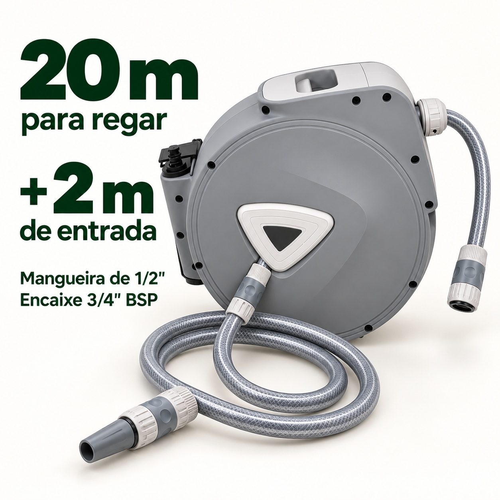
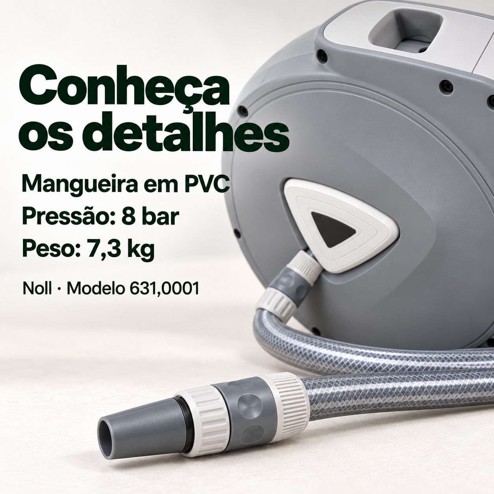

# Noll 卷管器 · 巴西 Shopee 高清方图

5 张独立商品详情图；1254 × 1254 px；1:1；JPG；图内语言为巴西葡萄牙语。

[下载本次5张图片 ZIP](https://github.com/ChaoDamn/-/raw/refs/heads/main/noll-mangueira-shopee-br-1x1/noll-mangueira-shopee-br-1x1.zip)

## 1. 庭院整洁收纳 / Jardim organizado

[下载 JPG 原图](01-jardim-organizado.jpg)

## 2. 自动回卷 / Enrolamento automático

[下载 JPG 原图](02-recolhimento-automatico.jpg)

## 3. 安装连接 / Instalação

[下载 JPG 原图](03-instalacao.jpg)

## 4. 管长与接口 / Comprimento e conexões

[下载 JPG 原图](04-comprimento-conexoes.jpg)

## 5. 细节与参数 / Detalhes e especificações

[下载 JPG 原图](05-detalhes-especificacoes.jpg)

商品资料：Noll，型号631,0001，PVC软管1/2英寸，20m出水管＋2m进水管，3/4英寸BSP，压力8bar，重量7,3kg。参数来自用户提供的商品资料。

水龙头、工具和庭院环境为场景示意；安装以原产品说明书为准。
